# Especificación Técnica BPMN y Matriz de Trazabilidad Proceso → Servicio SOA

**Proyecto:** NovaSalud Clinic - Sistema Integrado de Citas y Farmacia  
**Curso:** Arquitectura Orientada a Servicios (SOA) – Entregable APF3 (2026)  
**Fecha de Creación:** 08/11/2026  
**Versión:** 3.2.1  
**Estado:** Oficial / Implementado en `main`  
**Autores:** Equipo de Arquitectura NovaSalud  

---

## 1. Contexto y Objetivos de la Integración BPM + SOA

En el diagnóstico inicial del sistema de salud NovaSalud (APF1), se evidenció una desconexión crítica entre la atención clínica ambulatoria y la gestión farmacéutica. La prescripción médica se redactaba como texto libre o se entregaba físicamente en papel, generando:
1. Errores de interpretación de posología y medicamentos.
2. Inconsistencia entre diagnósticos médicos e inventario disponible en farmacia.
3. Tiempos muertos de espera para el paciente y transcripción manual duplicada por el químico farmacéutico.

Para resolver esta problemática bajo el paradigma **BPM (Business Process Management)** y **SOA (Service-Oriented Architecture)** (APF2 y APF3), se modeló y automatizó el flujo integral de **Atención Médica y Prescripción Digital**, coordinando personas, sistemas legados, microservicios independientes, un **Orquestador Central de Procesos Clínicos** y un **Enterprise Service Bus (ESB)** basado en Apache Camel.

---

## 2. Descripción de Carriles (Swimlanes) del Proceso

El proceso de negocio se estructura en cinco (5) carriles de responsabilidad funcional y técnica:

| Carril | Actor / Entidad | Responsabilidad Operativa en el Proceso |
| :--- | :--- | :--- |
| **Carril 1: Recepción** | Personal de Admisión | Identificación del paciente, búsqueda por DNI o registro demográfico, asignación de especialidad/médico y programación de la cita médica. |
| **Carril 2: Caja** | Cajero(a) | Cobro de la consulta ambulatoria, registro del medio de pago, emisión del comprobante y cambio del estado de la cita a `PAGADO`. |
| **Carril 3: Médico Tratante** | Médico Especialista | Admisión del paciente en consultorio, anamnesis, diagnóstico clínico, selección de medicamentos del catálogo real de Farmacia, dosificación estructurada y finalización de la atención. |
| **Carril 4: Sistema SOA** | Orquestador & ESB | **Orquestador (`novasalud-orchestrator`):** Coordina la validación de pago en Citas, el registro clínico en Atención y el despacho de receta a Farmacia. **ESB (`novasalud-esb`):** Enrutamiento central, validación de JWT, correlación (`X-Correlation-ID`), auditoría, resiliencia y enriquecimiento (*Content Enricher*). |
| **Carril 5: Farmacia** | Químico Farmacéutico | Consulta enriquecida de recetas digitales pendientes, verificación de colegiatura médica y diagnóstico, validación de stock y dispensación al paciente. |

---

## 3. Diagrama BPMN del Proceso de Negocio (5 Carriles)

El siguiente diagrama formaliza el flujo de extremo a extremo, detallando eventos de inicio/fin, compuertas exclusivas de decisión (`XOR`), tareas de usuario, tareas automáticas de servicio (`Service Tasks`) y tareas de compensación/reintento asincrónico:

```mermaid
flowchart TD
    %% Definición de estilos
    classDef startEnd fill:#00703C,stroke:#0A5C36,stroke-width:2px,color:#fff;
    classDef userTask fill:#E8F5E9,stroke:#00703C,stroke-width:1.5px,color:#111827;
    classDef serviceTask fill:#E3F2FD,stroke:#1565C0,stroke-width:1.5px,color:#111827;
    classDef gateway fill:#FFF3E0,stroke:#E65100,stroke-width:1.5px,color:#111827;
    classDef errorTask fill:#FFEBEE,stroke:#C62828,stroke-width:1.5px,color:#111827;

    %% Carril 1: Recepción
    subgraph Lane1 ["🏊 Carril 1: Recepción (Admisión)"]
        node_start((Inicio: Paciente Solicita Cita)):::startEnd
        task_reg_paciente["1.1 Registrar / Validar Paciente"]:::userTask
        task_prog_cita["1.2 Programar Cita Médica\n(Estado: PENDIENTE)"]:::userTask
    end

    %% Carril 2: Caja
    subgraph Lane2 ["🏊 Carril 2: Caja (Facturación)"]
        task_cobro["2.1 Realizar Cobro de Consulta\n(Generar Pago)"]:::userTask
        task_actualiza_pago["2.2 Marcar Cita como PAGADA\n(Citas API)"]:::serviceTask
    end

    %% Carril 3: Médico
    subgraph Lane3 ["🏊 Carril 3: Médico Tratante"]
        task_iniciar_atencion["3.1 Llamar Paciente e Iniciar Consulta"]:::userTask
        task_diagnostico["3.2 Registrar Anamnesis y Diagnóstico"]:::userTask
        task_buscar_med["3.3 Consultar Catálogo Farmacia\n(Búsqueda en Grilla)"]:::userTask
        task_armar_receta["3.4 Estructurar Receta Médica\n(Dosis, Frecuencia, Cantidad)"]:::userTask
        task_finalizar["3.5 Guardar y Finalizar Atención"]:::userTask
        task_alerta_pago["Mostrar Alerta: Cita No Pagada\n(Atención Bloqueada)"]:::errorTask
        task_exito_medico["Visualizar Resumen y Estado Farmacia\n(ENVIADO / PENDIENTE)"]:::userTask
    end

    %% Carril 4: Sistema SOA (Orquestador + ESB)
    subgraph Lane4 ["🏊 Carril 4: Sistema SOA (Orquestador & ESB Camel)"]
        task_orq_inicio["4.1 Recibir Solicitud de Atención\n(POST /orquestacion/atencion)"]:::serviceTask
        gw_pago{¿Cita Pagada?}:::gateway
        task_reg_atencion["4.2 Registrar Atención Clínica\n(Atención API)"]:::serviceTask
        gw_receta{¿Incluye Receta?}:::gateway
        task_envio_farmacia["4.3 Transformar y Enviar Prescripción\n(Vía ESB -> Farmacia API)"]:::serviceTask
        gw_farmacia_resp{¿Farmacia Responde 201/200?}:::gateway
        task_marca_enviado["4.4 Marcar: ENVIADO_A_FARMACIA\n(atencion_medica)"]:::serviceTask
        task_marca_pendiente["4.5 Marcar: PENDIENTE_ENVIO_FARMACIA\n(atencion_medica)"]:::serviceTask
        task_scheduler["4.6 Tarea Programada de Reintentos\n(FarmaciaRetryListener cada 2 min)"]:::serviceTask
        task_content_enricher["4.7 Content Enricher ESB:\nCitas + Atención -> Receta Enriquecida"]:::serviceTask
    end

    %% Carril 5: Farmacia
    subgraph Lane5 ["🏊 Carril 5: Farmacia (Dispensación)"]
        task_recibe_receta["5.1 Almacenar Prescripción Canónica\n(Estado: PENDIENTE)"]:::serviceTask
        task_consultar_web["5.2 Listar Recetas en Farmacia Web\n(Vía ESB Enriquecido)"]:::userTask
        task_verificar_datos["5.3 Validar Paciente, CMP y Diagnóstico"]:::userTask
        task_dispensar["5.4 Dispensar Medicamentos y Cerrar\n(Estado: ATENDIDA)"]:::userTask
        node_fin((Fin: Proceso Completado)):::startEnd
    end

    %% Conexiones entre Carriles
    node_start --> task_reg_paciente
    task_reg_paciente --> task_prog_cita
    task_prog_cita --> task_cobro
    task_cobro --> task_actualiza_pago
    task_actualiza_pago --> task_iniciar_atencion

    task_iniciar_atencion --> task_diagnostico
    task_diagnostico --> task_buscar_med
    task_buscar_med --> task_armar_receta
    task_armar_receta --> task_finalizar
    task_finalizar --> task_orq_inicio

    %% Orquestación SOA
    task_orq_inicio --> gw_pago
    gw_pago -- "No (Pendiente)" --> task_alerta_pago
    gw_pago -- "Sí (PAGADO)" --> task_reg_atencion
    task_reg_atencion --> gw_receta

    gw_receta -- "No" --> task_exito_medico
    gw_receta -- "Sí" --> task_envio_farmacia

    task_envio_farmacia --> gw_farmacia_resp
    gw_farmacia_resp -- "201 / 409 Duplicada" --> task_marca_enviado
    gw_farmacia_resp -- "503 / Timeout / Caída" --> task_marca_pendiente

    task_marca_enviado --> task_recibe_receta
    task_recibe_receta --> task_exito_medico

    task_marca_pendiente --> task_exito_medico
    task_marca_pendiente -.-> task_scheduler
    task_scheduler -- "Reintento Exitoso" --> task_marca_enviado

    %% Flujo Farmacia
    task_recibe_receta --> task_consultar_web
    task_consultar_web --> task_content_enricher
    task_content_enricher --> task_verificar_datos
    task_verificar_datos --> task_dispensar
    task_dispensar --> node_fin
```

---

## 4. Diagrama de Secuencia SOA Ultra HD (EIP & Orquestación)

El siguiente diagrama de interacción ilustra la coreografía sincrónica y asincrónica entre los componentes distribuidos, destacando la propagación de seguridad (JWT Bearer), trazabilidad (X-Correlation-ID), orquestación clínica y el patrón *Content Enricher*:

> [!TIP]
> **Artefactos Gráficos Generados en Ultra HD:**
> - Imagen Renderizada en Ultra HD (PNG 3x): [08112026_secuencia_soa_orquestacion_eip.png](file:///d:/AREYES/UTP/2026-02/Arquitectura%20Orientada%20al%20Servicio/SistemaARQ/docs/architecture/08112026_secuencia_soa_orquestacion_eip.png)
> - Vectorial Escalable (SVG): [08112026_secuencia_soa_orquestacion_eip.svg](file:///d:/AREYES/UTP/2026-02/Arquitectura%20Orientada%20al%20Servicio/SistemaARQ/docs/architecture/08112026_secuencia_soa_orquestacion_eip.svg)
> - Código Fuente Mermaid: [08112026_secuencia_soa_orquestacion_eip.mmd](file:///d:/AREYES/UTP/2026-02/Arquitectura%20Orientada%20al%20Servicio/SistemaARQ/docs/architecture/08112026_secuencia_soa_orquestacion_eip.mmd)

`mermaid
sequenceDiagram
    autonumber

    box "Capa de Presentación Web" #F1F8F4
        actor Medico as 👨‍⚕️ Médico Tratante
        participant Web as 🖥️ Frontend Citas (8080)
        participant FarmWeb as 🖥️ Farmacia Web (8081)
    end

    box "Capa de Integración & Orquestación SOA" #EBF3FB
        participant ESB as 🚌 ESB Apache Camel (8086)
        participant Orq as ⚙️ Orquestador SOA (8083)
    end

    box "Capa de Microservicios Backend" #FDF6EC
        participant Citas as 🗄️ Citas API (8084)
        participant Atencion as 🗄️ Atención API (8082)
        participant Farmacia as 💊 Farmacia API (8085)
    end

    %% FASE 1: INVOCACIÓN DE ATENCIÓN MÉDICA
    rect rgb(240, 248, 255)
        note over Medico, Web: Fase 1: Finalización de Atención y Despacho de Receta
        Medico->>+Web: 1. Presiona "Guardar y Finalizar Atención"
        Note over Web: Inyecta encabezados HTTP: Authorization: Bearer [JWT_TOKEN] X-Correlation-ID: WEB-e8a201bf
        Web->>+ESB: 2. POST /esb/orquestacion/orquestacion/atencion
        Note over ESB: SecurityPolicyProcessor: Valida JWT con clave común. CorrelationIdProcessor: Propaga X-Correlation-ID. AuditLogProcessor: Registra inicio de traza SOA.
        ESB->>+Orq: 3. POST /api/orquestacion/atencion
    end

    %% FASE 2: VALIDACIÓN DE PAGO EN CITAS API
    rect rgb(254, 249, 231)
        note over Orq, Citas: Fase 2: Validación de Regla de Negocio (Cita Pagada)
        Orq->>+ESB: 4. GET /esb/citas/citas/{idCita}
        ESB->>+Citas: 5. GET /api/citas/{idCita}
        Citas-->>-ESB: 6. 200 OK { idCita: 40, estadoPago: "PAGADO", idPaciente: 3 }
        ESB-->>-Orq: 7. 200 OK (Cita Pagada Verificada)
    end

    %% FASE 3: PERSISTENCIA CLÍNICA
    rect rgb(245, 238, 248)
        note over Orq, Atencion: Fase 3: Registro de Atención e Historia Clínica
        Orq->>+ESB: 8. POST /esb/atencion/atencion-medica
        Note over Orq, Atencion: Payload incluye estado inicial: PENDIENTE_ENVIO_FARMACIA
        ESB->>+Atencion: 9. POST /api/atencion-medica { idCita: 40, diagnostico: "Faringitis" }
        Atencion-->>-ESB: 10. 201 Created { idAtencion: 25 }
        ESB-->>-Orq: 11. 201 Created
    end

    %% FASE 4: DESPACHO A FARMACIA Y RESILIENCIA
    rect rgb(234, 250, 234)
        note over Orq, Farmacia: Fase 4: Integración con Farmacia (Idempotencia y Resiliencia)
        Orq->>+ESB: 12. POST /esb/farmacia/prescripciones
        Note over Orq, ESB: Mensaje Canónico: RX-25, idAtencionExterna: 25, medicamentos: [...]
        ESB->>+Farmacia: 13. POST /api/prescripciones

        alt Farmacia Disponible (201 Created o 409 Duplicada)
            Farmacia-->>ESB: 14a. 201 Created { idPrescripcion: 101, codigo: "RX-25" }
            ESB-->>Orq: 15a. 201 Created
            Orq->>+ESB: 16a. PUT /esb/atencion/atencion-medica/25/estado-farmacia
            ESB->>+Atencion: 17a. PUT ... { estadoFarmacia: "ENVIADO_A_FARMACIA" }
            Atencion-->>-ESB: 18a. 200 OK
            ESB-->>-Orq: 19a. 200 OK
            Orq-->>ESB: 20a. 200 OK { success: true, estado: "ENVIADO_A_FARMACIA" }
            ESB-->>Web: 21a. 200 OK (X-Correlation-ID preservado)
            Web-->>Medico: 22a. Muestra Banner Verde: "Atención Registrada y Receta Enviada a Farmacia"
        else Farmacia No Disponible (503 Service Unavailable / Timeout)
            Farmacia-->>-ESB: 14b. Conexión rechazada / 503
            ESB-->>-Orq: 15b. 503 Servicio No Disponible
            Note over Orq: Atencion queda persistida como PENDIENTE_ENVIO_FARMACIA. No se interrumpe la consulta del médico.
            Orq-->>-ESB: 16b. 200 OK { success: true, estado: "PENDIENTE_ENVIO_FARMACIA" }
            ESB-->>-Web: 17b. 200 OK (Alerta de Resiliencia)
            Web-->>-Medico: 18b. Muestra Banner Amarillo: "Atención Guardada (Receta Pendiente de Envío)"
            
            note over Orq, Farmacia: Tarea Programada de Recuperación en Background
            loop Cada 2 minutos (FarmaciaRetryListener)
                Orq->>Atencion: Consulta atenciones con estado PENDIENTE_ENVIO_FARMACIA
                Orq->>Farmacia: Reintenta envío de prescripción RX-25
                Note over Orq, Farmacia: Al restablecerse Farmacia -> actualiza a ENVIADO_A_FARMACIA
            end
        end
    end

    %% FASE 5: CONSULTA ENRIQUECIDA (CONTENT ENRICHER EIP)
    rect rgb(253, 237, 236)
        note over FarmWeb, Atencion: Fase 5: Consulta Enriquecida de Recetas en Farmacia Web (Content Enricher)
        actor QF as 🧑‍🔬 Químico Farmacéutico
        QF->>+FarmWeb: 23. Ingresa a Pantalla de Prescripciones
        FarmWeb->>+ESB: 24. GET /esb/farmacia/prescripciones (Authorization: Bearer)
        ESB->>+Farmacia: 25. GET /api/prescripciones
        Farmacia-->>-ESB: 26. 200 OK [ { idPrescripcion: 101, codigo: "RX-25", idPacienteExterno: 3, idMedicoExterno: 1, idAtencionExterna: 25 } ]

        Note over ESB: PrescripcionContentEnricherProcessor: Detecta IDs externos y enriquece la respuesta (Caché local por petición)
        
        par Enriquecimiento de Paciente
            ESB->>+Citas: 27. GET /api/pacientes/3
            Citas-->>-ESB: 28. 200 OK { nombres: "Lucía", apellidos: "Morales", dni: "70123456" }
        and Enriquecimiento de Médico y CMP
            ESB->>+Citas: 29. GET /api/medicos/1
            Citas-->>-ESB: 30. 200 OK { nombres: "Valeria", apellidos: "Rojas", cmp: "CMP-45892" }
        and Enriquecimiento de Diagnóstico Clínico
            ESB->>+Atencion: 31. GET /api/atencion-medica/25
            Atencion-->>-ESB: 32. 200 OK { diagnostico: "Faringitis Aguda" }
        end

        Note over ESB: Calcula fechas: emisión (hoy) y vencimiento (+7 días). Compone payload enriquecido final.
        ESB-->>-FarmWeb: 33. 200 OK [ Receta Enriquecida con Paciente Real, CMP Real y Diagnóstico ]
        FarmWeb-->>-QF: 34. Renderiza Grilla con Datos Clínicos y Modal de Medicamentos
        QF->>FarmWeb: 35. Valida Receta y Presiona "Dispensar"
    end

`

---

## 5. Matriz Maestra de Trazabilidad Proceso → Servicio SOA

Esta matriz vincula cada paso del proceso de negocio BPMN con los contratos, endpoints, métodos y componentes de la arquitectura orientada a servicios:

| # | Tarea del Proceso BPMN | Carril (Actor) | Tipo Tarea | Servicio SOA Invocado | Endpoint REST | Método | Mensaje Entrada (Payload) | Mensaje Salida / Retorno | Patrón EIP / Resiliencia |
| :---: | :--- | :--- | :---: | :--- | :--- | :---: | :--- | :--- | :--- |
| **T1** | Búsqueda / Registro de Paciente | Recepción | Usuario / Servicio | `novasalud-citas-api` | `/api/pacientes` `/api/pacientes/buscar/dni/{dni}` | `GET` `POST` | `{"dni":"70123456", "nombres":"Lucía", ...}` | `{"idPaciente":3, "estado":"ACTIVO"}` | Point-to-Point REST / Validación de unicidad |
| **T2** | Programación de Cita Médica | Recepción | Usuario / Servicio | `novasalud-citas-api` | `/api/citas` | `POST` | `{"idPaciente":3, "idMedico":1, "fecha":"2026-11-09", "hora":"10:00"}` | `{"idCita":40, "estado":"PENDIENTE", "estadoPago":"PENDIENTE"}` | Service Invocation / Bloqueo de solapamiento |
| **T3** | Cobro y Facturación de Consulta | Caja | Usuario / Servicio | `novasalud-citas-api` | `/api/pagos` | `POST` | `{"idCita":40, "monto":80.00, "metodoPago":"TARJETA"}` | `{"idPago":12, "estado":"COMPLETADO"}` | Transactional Update / Actualiza `cita.estado_pago = 'PAGADO'` |
| **T4** | Consulta de Catálogo de Medicamentos | Médico | Usuario / Servicio | `novasalud-farmacia-api` (vía Citas Web BFF) | `/api/medicamentos?q={criterio}` | `GET` | Parámetro `q=paracetamol` | `[{"idMedicamento":1, "nombre":"Paracetamol 500mg", "stock":150, "precio":1.50}]` | Content-Based Router / Filtro LIKE con límite |
| **T5** | Invocación de Orquestación Clínica | Médico | Servicio | `novasalud-orchestrator` (vía ESB) | `/esb/orquestacion/orquestacion/atencion` | `POST` | `AtencionProcessRequest`: `{idCita:40, idMedico:1, diagnostico:"...", prescripcion:{...}}` | `AtencionProcessResponse`: `{success:true, idAtencion:25, correlationId:"..."}` | **Process Orchestration (SOA)** / Propagación de `X-Correlation-ID` |
| **T6** | Validación de Regla de Pago | Sistema | Regla / Servicio | `novasalud-citas-api` (vía ESB) | `/esb/citas/citas/{idCita}` | `GET` | PathParam `idCita=40` | `{"idCita":40, "estadoPago":"PAGADO", ...}` | Guard Constraint / Si != `PAGADO` detiene flujo (400 `ERROR_CITA_NO_PAGADA`) |
| **T7** | Persistencia de Atención Clínica | Sistema | Servicio | `novasalud-atencion-api` (vía ESB) | `/esb/atencion/atencion-medica` | `POST` | `{"idCita":40, "idPaciente":3, "diagnostico":"...", "estadoFarmacia":"PENDIENTE_ENVIO_FARMACIA"}` | `{"idAtencion":25, "estadoRegistro":"ACTIVO"}` | Service Task / Persistencia en `bd_citasmedicas_v321` |
| **T8** | Enrutamiento de Prescripción Digital | Sistema | Servicio | `novasalud-farmacia-api` (vía ESB) | `/esb/farmacia/prescripciones` | `POST` | Mensaje Canónico: `{codigoPrescripcion:"RX-25", idAtencionExterna:25, medicamentos:[...]}` | `{"idPrescripcion":101, "codigo":"RX-25"}` | **Message Router + Idempotent Consumer** / 409 tratado como éxito idempotente |
| **T9** | Actualización de Estado de Prescripción | Sistema | Servicio | `novasalud-atencion-api` (vía ESB) | `/esb/atencion/atencion-medica/{id}/estado-farmacia` | `PUT` | `{"estadoFarmacia":"ENVIADO_A_FARMACIA"}` | `{"success":true}` | Service Task / Reflejo de confirmación en historia clínica |
| **T10** | Reintento Automático en Background | Sistema | Servicio / Timer | `novasalud-orchestrator` | Tarea en background (Scheduler 2 min) | Interno | Consulta `GET /pendientes-farmacia` | Reenvía a Farmacia API y actualiza a `ENVIADO_A_FARMACIA` | **Retry Pattern & Guaranteed Delivery** / Resiliencia ante caída de Farmacia |
| **T11** | Consulta Enriquecida de Recetas | Farmacia | Usuario / Servicio | `novasalud-esb` (Camel) | `/esb/farmacia/prescripciones` `/esb/farmacia/prescripciones/{id}` | `GET` | Encabezado `Authorization: Bearer <token>` | `[{"codigoPrescripcion":"RX-25", "nombrePaciente":"Lucía Morales", "dniPaciente":"70123456", "nombreMedico":"Dr. Valeria Rojas", "numeroColegiaturaMedico":"CMP-45892", "diagnostico":"Faringitis", ...}]` | **Content Enricher (EIP)** / Agregación distribuida en paralelo con caché local |
| **T12** | Dispensación y Cierre de Receta | Farmacia | Usuario / Servicio | `novasalud-farmacia-api` (vía ESB) | `/esb/farmacia/prescripciones/{id}` | `POST` / `PUT` | `{"estado":"ATENDIDA", "usuario":"qf_martinez"}` | `{"success":true, "estado":"ATENDIDA"}` | State Transition / Descuento de stock en `bd_famacia` |

---

## 6. Principios de Diseño SOA Aplicados en la Solución

De acuerdo con los principios de arquitectura de Thomas Erl y los criterios de evaluación del APF3:

1. **Contratos Estandarizados (Standardized Service Contract):**
   - Definición formal en `/contratos/CONTRATO_PRESCRIPCION.md` y schemas JSON (`prescripcion-canonica.schema.json` y `prescripcion-farmacia.schema.json`).
   - Todos los servicios exponen documentación Swagger/OpenAPI 3.0 en contexto relativo.
2. **Bajo Acoplamiento (Service Loose Coupling):**
   - `novasalud-farmacia-api` no conoce la estructura ni la base de datos de Citas. Farmacia solo recibe identificadores externos y delega la composición al ESB (Decisión de Diseño "Opción 1").
3. **Abstracción del Servicio (Service Abstraction):**
   - Los frontends web no conocen la ubicación física de las APIs; se comunican únicamente con el ESB (`novasalud-esb:8080/novasalud-esb/esb/*`).
4. **Reusabilidad del Servicio (Service Reusability):**
   - Endpoints como `GET /pacientes/{id}` y `GET /medicos/{id}` son reutilizados tanto por la admisión, como por la agenda clínica y por el *Content Enricher* del ESB.
5. **Autonomía del Servicio (Service Autonomy):**
   - Cada servicio cuenta con su propio despliegue Docker y su propia persistencia (`bd_citasmedicas_v321` y `bd_famacia`), pudiendo operar de manera independiente.
6. **Sin Estado (Service Statelessness):**
   - Las solicitudes son independientes y portan su estado de seguridad mediante tokens criptográficos **JWT Bearer**, evitando sesiones compartidas en servidor.
7. **Descubribilidad (Service Discoverability):**
   - Registro unificado de endpoints a través del ESB (`/esb/health`, `/esb/citas`, `/esb/atencion`, `/esb/farmacia`, `/esb/orquestacion`).
8. **Composabilidad (Service Composability):**
   - El proceso de atención médica es un servicio compuesto orquestado por `novasalud-orchestrator`, coordinando transacciones entre Citas, Atención y Farmacia.

